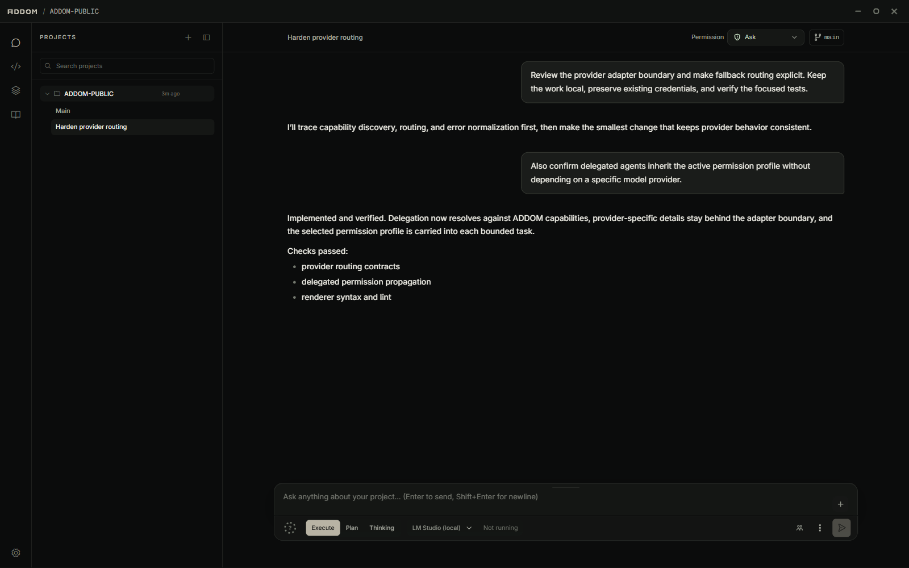
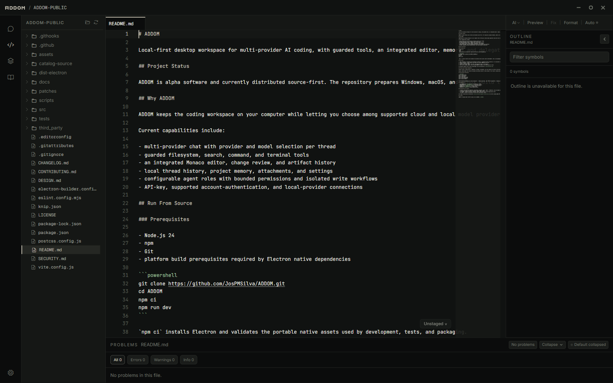
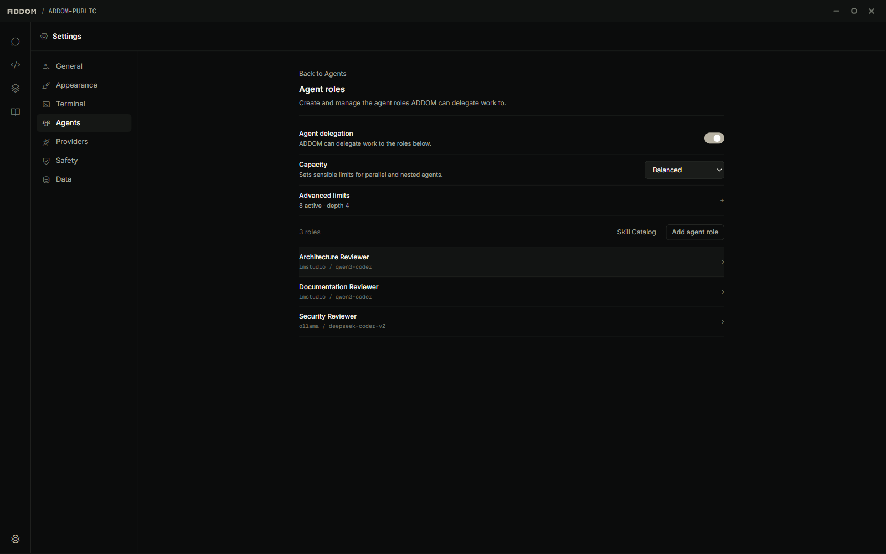
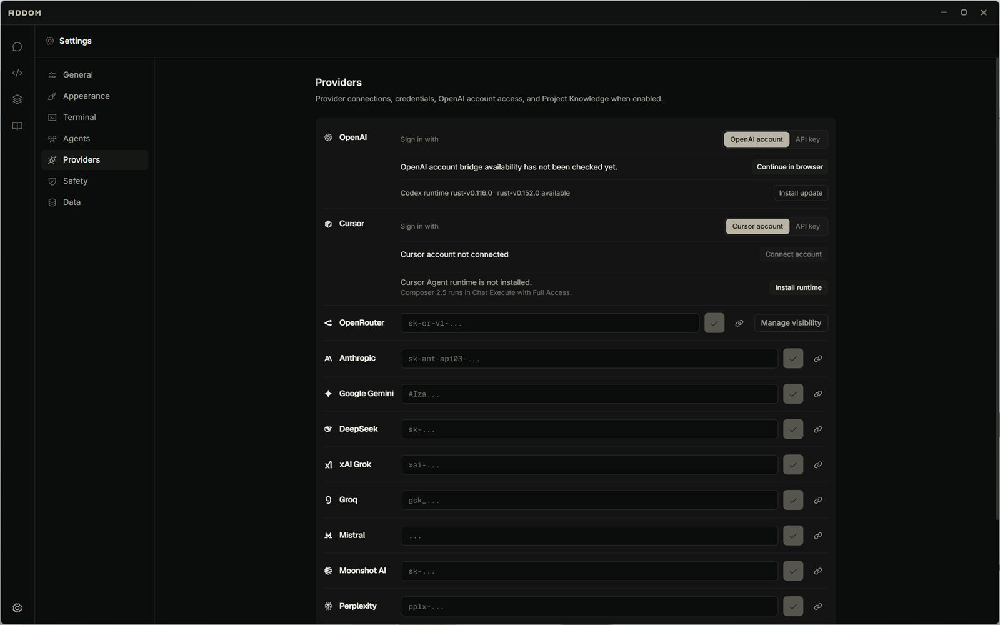

# ADDOM

Local-first desktop workspace for multi-provider AI coding, with guarded tools, an integrated editor, memory, and delegated agents. No telemetry or data collection by the ADDOM developer.

[Website](https://www.addom.app) · [Microsoft Store](https://apps.microsoft.com/detail/9N3MG7BJRSRB) · [Releases](https://github.com/JosPMSilva/ADDOM/releases)



## Project Status

The current ADDOM release is `0.2.0-beta`. ADDOM remains beta software. Preview builds are prepared for Windows, macOS, and Linux; the Windows installer has been qualified locally, while macOS and Linux builds need broader platform testing. GitHub-hosted packages are currently unsigned. Windows builds distributed through GitHub can check, download, and install updates from ADDOM's official published GitHub releases. Packages acquired through Microsoft Store are signed and updated by Microsoft instead; the in-app update controls identify that managed channel. macOS and Linux updates remain manual while their packaging paths are hardened.

Non-English UI coverage is still incomplete in `0.2.0-beta`. The language setting translates supported renderer copy, but some newer and less common surfaces still fall back to English. Commands, file paths, provider and model identifiers, protocol names, and other support-critical technical tokens remain canonical English by design. Provider and model paths have automated coverage, but live qualification with paid API credits is incomplete.

## Install on Windows

[Get ADDOM from Microsoft Store](https://apps.microsoft.com/detail/9N3MG7BJRSRB)
for a signed Windows package with Store-managed updates. The same package is
available from the terminal through WinGet:

```powershell
winget install --id 9N3MG7BJRSRB --exact --source msstore
```

The Store package is signed and updated by Microsoft. The GitHub release also
provides an unsigned Windows installer for users who prefer the independent
GitHub distribution and its in-app update channel. See
[Windows Store and WinGet](./docs/windows-store-and-winget.md) for installation,
updates, channel differences, and troubleshooting.

## Why ADDOM

ADDOM keeps the coding workspace on your computer while letting you choose among supported cloud and local model providers. It combines conversation, project-aware tools, reviewable changes, and agent delegation in one Electron application.

Current capabilities include:

- multi-provider chat with provider and model selection per thread
- guarded filesystem, search, command, and terminal tools
- an integrated Monaco editor, change review, and artifact history
- local thread history, project memory, attachments, and settings
- configurable agent roles with bounded permissions and isolated write workflows
- API-key, supported account-authentication, and local-provider connections

## Run From Source

### Prerequisites

- Node.js 24
- npm
- Git
- platform build prerequisites required by Electron native dependencies
  - On Windows, install Python and Visual Studio Build Tools with the **Desktop development with C++** workload if npm needs to compile a native dependency locally.

```powershell
git clone https://github.com/JosPMSilva/ADDOM.git
cd ADDOM
npm ci
npm run dev
```

`npm ci` installs Electron and validates the portable native assets used by development, tests, and packaging.

## First Run

1. Open **Settings > Providers** and configure an API key, a supported account connection, or an available local provider.
2. Select **Projects > Open folder** and choose the project ADDOM may work with.
3. Create or select a thread.
4. Choose the provider, model, chat mode, and permission mode in the composer.
5. Start with a scoped request, such as asking ADDOM to inspect a file and explain an issue.

For approval behavior and a fuller walkthrough, see the [Quickstart](./docs/quickstart.md).

## Privacy And Provider Boundaries

Project records, thread history, credentials, settings, attachments, and local memory are stored on the device. ADDOM does not include remote telemetry.

Using a remote model still sends the prompt and selected context to that provider. Tool results, hosted provider tools, MCP integrations, and files explicitly added to Project Knowledge may also leave the device according to the selected provider or service. Review provider terms and the active permission mode before working with sensitive repositories.

See the [ADDOM Privacy Policy](./PRIVACY.md) for local-data controls, provider boundaries, and Microsoft Store distribution details.

## Verification And Builds

```powershell
npm run check:syntax
npm run check:eslint
npm run i18n:check
npm run check:docs-links
npm run check:public-docs
npm run test:integration
npm run build:renderer
```

Platform package commands are `npm run build:win`, `npm run build:mac`, and `npm run build:linux`. Build a platform target on its native host; generated packages are unsigned unless signing is configured externally. The separate `npm run build:store:win` flavor uses Microsoft Store identity and update ownership; see [Windows Store and WinGet](./docs/windows-store-and-winget.md).

## Screenshots

**Integrated editor** — project source, symbol outline, problems, and reviewable changes next to the conversation that produced them.



**Agent roles** — delegate bounded tasks to specialist roles, each with its own provider, model, skills, and working scope.



**Provider connections** — configure supported cloud and local providers once, then choose per thread.



## Documentation

- [docs/README.md](./docs/README.md) — documentation index
- [CONTRIBUTING.md](./CONTRIBUTING.md) — contributor workflow
- [SECURITY.md](./SECURITY.md) — security reporting policy
- [PRIVACY.md](./PRIVACY.md) — privacy policy and provider boundaries
- [Code signing policy](./docs/code-signing-policy.md) — release provenance,
  signing roles, and current signing status
- [CHANGELOG.md](./CHANGELOG.md) — release notes

## Architecture At A Glance

- `src/main` owns Electron integration, persistence, providers, tools, agents, credentials, and privileged operations.
- `src/preload` exposes the narrow, versioned `window.addom` bridge.
- `src/renderer` contains the React interface, editor, settings, and projected application state.
- `src/common` contains cross-process contracts and shared policy logic.

See [Agent Orchestration Architecture](./docs/architecture/agent-orchestration.md) and the [window.addom API reference](./docs/reference/window-addom-api.md) for deeper implementation detail.

## License

ADDOM is released under the MIT License. See [LICENSE](./LICENSE).
